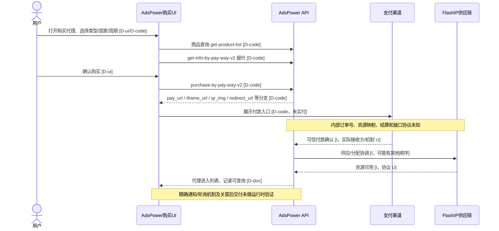
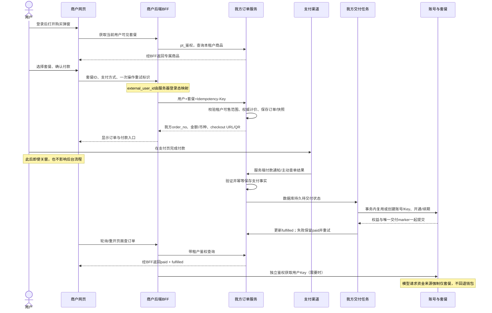

# AdsPower × FlashIP 内嵌购买链路调查

观察日期：2026-11-11。状态：公开证据研究完成，业务实现未批准。

## 0. 结论与证据边界

**最有依据的解释是：AdsPower 自己实现购买 UI，通过 AdsPower 的已登录请求层查询商品、报价和提交购买；FlashIP 作为供应商，资源最终回到 AdsPower 管理。不能再仅凭弹窗形态优先断言“供应商 H5 iframe”。**

- **直接证据·公开静态代码**：AdsPower 官方网站链接的 Web 应用，公开构建包含 Vue `BuyProxy`、`ProxyTypeCard`、`PayDialog` 组件，以及 AdsPower 自己的商品、报价、购买 API 调用点。它不是只包含一个指向 FlashIP 商城的 iframe。
- **直接证据·官方说明**：购买后代理分配、进入 AdsPower 代理列表，可刷新并在费用中心/操作日志查看记录。
- **合理推断**：供应商资源与 AdsPower 团队/订单在服务端关联；很可能存在后台供应链调用，但未观察它，不能给出真实服务端接口、结算或通知协议。
- **未知**：用户截图对应的确切客户端版本、运行时 DOM、发出的购买请求。公开构建可证明代码存在及其调用结构，不能证明某个灰度版本必然执行了这些分支。

全程只打开公开页面、读取页面引用的静态 JS 和本地项目源码。未登录、未创建订单、未提交支付、未主动调用鉴权/报价/下单业务 API，未绕过区域或访问限制。页面正常加载自身的公开配置/会话探测不等于已验证交易请求。本次没有登录态 HAR，也没有后端源码或支付回调日志。

证据标记：**D-doc** 官方文档直接陈述；**D-code** 公开发布代码直接存在；**D-ui** 截图可见；**I** 合理推断；**U** 未知。静态调用点 ≠ 已观察成功的请求 ≠ 已验证后端安全语义。

## 1. 来源与可复核记录

### S1 AdsPower 官方代理帮助

https://help.adspower.com/docs/proxy_list

本次通过真实浏览器读取，页尾 Last modified: 2026-10-16。

原文：

> AdsPower acts solely as a platform, enabling users to directly place orders with the proxy provider FlashID to purchase proxy and providing management capabilities.

> Only USD wallet payments are supported.

> After purchase, it takes some time for the system to assign proxies. Please click the "Refresh" button to retrieve data or go to the [Billing Center] to check the deduction record and the [Action Log] to check the purchase record to confirm.

自动续费提到 Team USD Wallet。动态代理的“每 6 分钟刷新”说的是用量统计，**不是订单状态轮询间隔**。

存档：`help-proxy-content.json`、`browser-help-proxy-list.json`。

### S2 AdsPower 官方 FlashIP 合作伙伴页

https://www.adspower.net/partner/flaship

将 FlashIP 描述为全球代理网络，包含动态住宅、静态 ISP、移动、数据中心代理。确认公开品牌/合作关系，不证明后台付款或用户映射协议。

### S3 AdsPower 官方购买指南

https://www.adspower.net/blog/adspower-proxy-ip

明确支持在客户端代理入口购买，列出钱包、支付宝、微信、银行卡、PayPal、PIX、VietQR、MOMO；付款后自动添加至代理列表。与截图的多支付方式方向一致。

它写自动续期到期前 24 小时，S1 写 72 小时，进一步表明公开说明存在版本/入口差异。不能按文档日期自动宣布哪一条代表截图。无需为本任务认定自动续费的现行数值。

### S4 AdsPower 官方 FlashIP 词条

https://www.adspower.com/glossary/docs/static-residential-proxy

明确写 `AdsPower integrates FlashIP directly into the dashboard`、`FlashIP pop-up window`，但仍列 USD wallet only。这证明文案命名也不一致，不能只按 FlashID/FlashIP 拼写判定两个购买入口。

### S5 AdsPower 官方分发的应用代码（核心证据）

官网 https://www.adspower.com/ 的 Log in 指向 https://app.adspower.com/login 。本次只打开其公开登录页。

HTML 直接引用：

`https://app.adspower.com/static/js/index.BNd-KH2l.js`

该脚本 import `_fa53b.CgzvWMYp.js`，实际读取的文件为：

`https://app.adspower.com/static/js/_fa53b.CgzvWMYp.js`

UTF-8 解码文本长度：3,036,595 字符。UTF-8 文本 SHA-256：

`596d4ec26f7933e3ba74736b67f33893ec84c80c2f51a95cf6af0935666ae7a1`

这是解码文本摘要，不是 gzip 网络字节摘要。以下偏移量以该文本 JS 字符索引计；构建更新后 hash/偏移可能变化。

| 偏移（约） | 代码事实 | 结论 |
| --- | --- | --- |
| 947,657 | `flashid:{value:"flashid",label:"FlashIP"}` | 在该供应商枚举中 `flashid` 显示成 FlashIP；不是两个可直接区分的供应商枚举项 |
| 950,306 | 品牌链接 `https://www.flaship.net/?ref=AdsPower` | 此购买模块确实关联 FlashIP 官网 |
| 1,024,260 | Vue `name:"BuyProxy"`，引用自己的 `PayDialog`，产品、国家、数量、期限、优惠码等组件 | 公开构建由宿主自己渲染购买界面 |
| 996,628 | GET `fbcc/proxy-product/get-product-list`，`proxy_agent`、`agent_type`、`currency_code` | 宿主查询指定供应商商品；不能据此推导任意商户的专属 SKU 隔离能力 |
| 826,967 | POST `payment/pay/get-info-by-pay-way-v2`，`{product,payment}` | 宿主报价/支付信息层 |
| 938,453 | POST `payment/pay/purchase-by-pay-way-v2`，`{product,payment}` | 购买提交到宿主请求层，不是把官网商城 URL 作为购买页 |
| 878,699 附近 | `onHandlePayResult` 处理 `pay_url`、`iframe_url`、`qr_img`、`redirect_url` | 支付结果可采用二维码、支付 iframe 或外部跳转；支付 iframe ≠ 商品购买页 iframe |
| 671,900 附近 | app 域推导 api 域作为 base URL；共享请求层使用登录凭证并添加鉴权/加密头 | Web 构建的上述相对路径按配置走 AdsPower API；本次未发送这些购买请求 |
| 941,800 附近 | 完成分支对静态代理提示 assignment pending | UI 完成动作不等于供应商已分配完毕 |

请求结构摘录（**静态定义，不是调用实测**）：

```js
// BuyProxy 构造商品参数
{ type: "purchase_proxy", proxyProductId, num, day, isAutoRenew, couponCode }

// 请求适配层映射成 product + payment
product: {
  type, proxy_product_id, num, day, is_auto_renew, coupon_code
}
payment: {
  is_used_balance, is_used_cashback, is_used_power,
  pay_info: { pay_way, payment_ext }, trace_id
}
```

前端自己生成了带时间和随机成分的 `trace_id` 用于提交/埋点。**它不是已经证实的平台订单号，也未证实是后端幂等键。** 本次摘录没有确认 AdsPower 业务订单号字段或生成算法。

取证文件：`adspower-script-response.json`、`adspower-linked-static-excerpts.json`、`adspower-buyproxy-component.json`、`adspower-payment-static-refs.json`、`adspower-paydialog-detail.json`、`adspower-payment-result-flow.json`。

### S6 FlashIP 独立控制台公开代码（必须与 S5 分开归因）

官网 https://www.flaship.net/ 将 Get proxies 指向 https://app.flaship.net ，未登录时重定向登录页。

公开文件：

- `https://app.flaship.net/assets/index-ni4ttVJP.js`
  - UTF-8 文本 SHA-256 `15d959734616e45dba74e6cb4489ad2ebebcad7d403543236242a65195022eeb`
  - `appName:"FlashIP"`，`serverUrl:"https://api.flaship.net"`。
  - 订单相关路径由请求拦截器使用 `serverUrl + "/flashipapi/v1"`，**不是同源 `/flashipapi/v1`**；普通认证/用户路径默认为 `serverUrl + "/v1"`。
- `https://app.flaship.net/assets/PurchasePage-CDnsC_15.js`
  - UTF-8 文本 SHA-256 `b726f1a3ede51732d046bd4ebb6ed9a2962976862f25480c92654d4e8b09dc47`
  - 静态代理报价 POST `/orders/proxy/quote`、创建 POST `/orders/proxy/create`，流量产品有 `/orders/traffic/quote` 与 `/orders/traffic/create`。
  - 创建请求含 SKU、数量、周期、是否使用余额、支付方式；响应读取 `order_no`、`payment_url`、`link_type`、`total_payable` 等字段。服务端返回订单号是代码事实；服务端内部如何生成及渠道号映射未知。
  - GET `/orders/status`，参数 `order_no`，读取 `pay_status`。
  - 未完成时 `setTimeout(..., 3e3)` 继续查询，组件卸载清理定时器；这是**上一请求完成后再等 3 秒**，不是精确每 3 秒开始一次。2 小时前端倒计时不证明后台订单过期政策。
  - `link_type === "url"` 可 `window.open` 外部付款；QR 类型走二维码/加密货币信息展示。
  - `paid` 后刷新钱包、代理列表和购买状态。前端的 `paid` 不提供独立“所有资源交付完成”的证据。
- `https://app.flaship.net/assets/rootauth-session-orchestrator-CmwH1t4D.js`
  - 读取 `authorizationCode`，提交 `authorization_code` 与 `device_id` 至 `rootAuthLogin`。
  - 主文件定义 `rootAuthLogin:"/auth/root_auth_login"`，RootAuth 配置引用 `https://rootauth-api.flashid.app`。

**上述授权码、订单字段及 3 秒轮询属于 FlashIP 独立控制台代码；不能替换成 AdsPower 内嵌入口的已验证协议。** 没有执行登录或交易调用。

取证文件：`flaship-app-public.json`、`flaship-index-static-excerpts.json`、`flaship-checkout-static-detail.json`、`flaship-linked-public-chunks.json`。

### S7 FlashID 独立官网

https://www.flashid.net/

展示指纹浏览器、云手机等产品，并链接 `www.flashid.app` 注册入口。

**严谨结论**：FlashIP 代理品牌与 FlashID 浏览器/云手机有不同公开产品入口；AdsPower 购买供应商枚举又将 `flashid` 显示为 FlashIP，FlashIP 独立站也使用 FlashID 域下的认证基础设施。可以确认技术/标识交集，不能推出所有产品、账户、支付后台相同，更不能断言它们是毫无关系的两家公司。法人、股权、品牌历史与后台复用范围未核实。

## 2. 对五个问题的直接回答

| 问题 | 已确认 | 最可能解释 / 尚未确认 |
| --- | --- | --- |
| 谁渲染和维护购买页？ | S5 的 Vue BuyProxy + PayDialog + 商品选择组件由 AdsPower 分发；FlashIP 自己另有独立 React/MUI 控制台 | 高置信推断截图同类入口为宿主 UI 调宿主 API，而非直接嵌独立商城。维护组织及是否供应商贡献 SDK 无法从域名确定；客户端壳为 Electron/WebView 也不等于内层 iframe |
| 如何免重复登录？ | AdsPower 请求层利用宿主登录态；商品/支付请求中无“先登录 FlashIP”的 UI 步骤代码证据 | 更像宿主后端代理授权和资源归属；不一定为每个终端用户建立 FlashIP 账号。团队/用户/供应商账号的关联键、B2B 凭证、是否有 SSO/短会话未知。独立站 RootAuth 授权码不能当成 AdsPower SSO 证据 |
| 谁创建订单及收款？ | AdsPower 提交到自己的 purchase-by-pay-way-v2，响应可带付款展示字段。FlashIP 独立站服务端另返回 order_no/payment_url | 宿主后端协调支付与供应商交付最符合代码；AdsPower 内部业务号、供应商单号、支付交易号如何对应、法定收款方及分账协议未知 |
| 如何同步结果与关窗交付？ | AdsPower 有完成事件、刷新列表、assignment pending 提示与费用/日志记录。FlashIP 独立站有明确 3 秒延后轮询和卸载清理 | AdsPower 此入口用订单轮询、WebSocket、webhook 还是全局消息未证实。官方延迟分配记录和自动续费支持存在服务端持久任务的推断，但没有关窗后付款交付的实测。不能把手动“完成支付”按钮当作付款权威 |
| 合作商开发哪些？ | 不能从公开代码推出 AdsPower 与 FlashIP 私有 B2B 合同 | 可参考宿主自建 UI + 平台订单/交付 API；本项目具体职责见下面的建议。不是把逆向得到的内部接口当作开放合作商 API |

## 3. 竞品时序（分层标注，不虚构私有协议）



补充：FlashIP **独立控制台代码**的明确链路为 `quote → create → 服务端返回 order_no/payment_url → 外部付款入口 → GET orders/status 延后 3 秒重查 → paid 时刷新列表`。它有比 AdsPower 私有供应链更细的直接证据，但不能与上图混写成实测。

## 4. 对当前项目的核查

以下为当前工作树源码观察，不是生产环境验证。

| 能力 | 当前证据 | 与目标的差距 |
| --- | --- | --- |
| 商户专属商品 | `router/partner_tenant.go:18` GET plans；`controller/partner_tenant.go` / model 以租户筛选已启用计划 | 已有基础，不应再造一个不隔离的公用商城目录；下单也必须重验归属 |
| 独立用户 Key | `model/partner_tenant.go:218` ProvisionPartnerTenantAccount；`router/partner_tenant.go:19` PUT accounts | 可独立幂等获取/初建；不是普通只读 GET；禁用/撤销不能自动换新 |
| 套餐开通/续费 | `model/partner_tenant.go:345` GrantPartnerTenantSubscription | 目前要求账号先存在，是可信商户直接授权，不是我方收款订单 |
| 商户订单/支付链接 | `controller/partner_server_payment.go:188,307` 已有创建/查询；`router/partner-server-router.go` | 这是另一套 PartnerServer 身份与**钱包充值**，不能当作 Tenant 套餐购买，也不能直接混用账户 |
| 普通用户套餐订单 | `controller/subscription.go:189` 明确拒绝 partner-owned plan | 不能仅拿普通购买 URL 给商户用，更不能简单删隔离检查 |
| 不回退钱包 | 套餐 `AllowWalletOverflow=false`；`service/billing_session.go:396,451-478` 仍按可变用户偏好选择资金来源，默认可回退 | 需在明确的 Tenant 套餐模式资金选择入口强制仅订阅；只设钱包初始为 0 或单计划禁溢出不够。不应因此把旧 PartnerServer 充值用户也迁成仅套餐 |
| 接口文档 | 现有 `docs/partner-tenant-api.md` 仍写商户收款后直接 grant | 与用户新目标不同。后续实施批准后统一更新；本轮不覆盖用户未提交文档 |

## 5. 我方最小方案（全部为建议，不是竞品事实）

### 5.1 推荐：API-first，商户自建原生购买弹窗

这比“统一托管 H5”更贴近本次拿到的 AdsPower UI 证据，也更能复用当前项目后端。

- **商户前端**：在自己网页渲染专属套餐卡片、订单摘要、支付入口、支付/交付状态。不保存 `pt_` 密钥，不自行决定价格或开通成功。
- **商户后端 / BFF**：验证自己的登录 Cookie/session，从服务端会话取得稳定用户 ID，映射 `external_user_id`，以 `pt_` 凭证调用我方；不能把浏览器随便上传的 external ID 当作当前用户。只向浏览器暴露该用户自己的商品、订单状态及获准结果。
- **我方前端**：此 MVP 不必维护完整商城；仅在现有支付渠道需要时复用/提供付款落地页。第三方支付可新窗口/顶层跳转，不能要求所有渠道都能 iframe。
- **我方后端**：租户商品校验、权威计价、订单号生成、支付适配、可信付款确认、后台恢复交付、账号/Key 幂等初建、套餐开通、订单查询和独立 Key 接口。

不需要“把 AdsPower 用户登录到 FlashIP”的同款 SSO：用户已登录商户，商户后端的可信身份断言足够支撑下单；我方无需给浏览器建立完整用户登录会话。独立获取 Key 与购买接口不是同一操作。

### 5.2 建议接口职责（名称示意，新增部分未实现）

| 接口 | 状态 / 职责 |
| --- | --- |
| GET `/api/partner/v1/plans` | 已有；仅租户获准商品，商户后端访问 |
| PUT `/api/partner/v1/accounts` | 已有；独立 get-or-create Key，不因获取 Key 自动赠送套餐 |
| POST `/api/partner/v1/subscription-orders` | **建议新增**；external_user_id + plan_id + payment_method；Idempotency-Key 作重试身份；我方生成 order_no、权威金额/币种、checkout 输出 |
| GET `/api/partner/v1/subscription-orders/{order_no}` | **建议新增**；认证租户校验归属，返回 payment_status 与 fulfillment_status，不返回 Key |
| 支付渠道 notify 回调 | 我方服务端；按选用渠道合同验签/验来源、金额、币种、商户号、订单和渠道交易号；必要时主动向渠道查询 |
| 后台待交付任务 / 补偿扫描 | 我方内部；只处理已经可信确认已付款的订单；与浏览器生命周期无关 |
| 商户前端 `/my/...` BFF | 商户自建；每次校验当前登录用户的订单/Key 归属，禁止成为任意 external ID 的透传代理 |

计划只需要一个固定价格时，不必为模仿竞品额外增加独立 quote API：商品列表提供预览，下单以服务端金额为准并回显。若增加支付手续费、优惠码或多币种，增加 server quote/确认价变流程。

订单输入不接受任意 payable amount；截图里的 trace_id 也不替代我方持久幂等键。幂等键与生成的业务 order_no 是两个概念。

### 5.3 持久支付与恰好一次业务效果

推荐最少状态：

```text
payment_status: pending | paid | failed | expired
fulfillment_status: not_ready | pending | fulfilled | failed_retryable
```

- 收到可信付款确认，先幂等持久化支付事实及证据；金额/币种使用定点数或最小货币单位，冻结商品与权益快照。
- 再通过事务和唯一订单交付记录执行：校验资源状态 → 缺失时创建账号/Key → 开通/续期 → 交付 marker。付费事实不能随交付事务失败回滚。
- 并发回调、轮询、手动补偿都不能重复续期。后台任务可由数据库状态 + 定时扫描实现，MVP 不必先引入新消息队列。
- 用户支付后关闭购买窗口，支付渠道仍通知我方；后台照常交付。回调丢失时，定时对账/主动查单恢复，而不是依赖页面保持打开。
- 已支付但账号被禁用、计划失效或交付失败，不自动换 Key、不再次扣款；保留明确状态和运营恢复/退款处理入口。具体退款实现不属于本 MVP。
- 网页“我已支付”、return_url 或 postMessage 只能请求刷新，不是付款凭据。
- 支付过期后的晚到回调/渠道支付在途必须核实，不盲目丢弃真实付款，也不直接对已付款订单再次收款。

### 5.4 前端同步最小化

商户前端 → 商户 BFF → 我方订单查询，采用退避轮询（例如 2、3、5 秒，最终上限 10 秒；这是建议参数），窗口可见时刷新，恢复页面时继续查询历史订单。

- MVP 可以不做我方到商户的 webhook；**支付渠道到我方的可信服务端确认不可省**。
- 后续有无人值守商户通知需求再加签名 webhook、事件 ID 去重、重试和对账。商户收到后仍以我方订单查询为最终状态。
- API-first 没有跨域 iframe，就不需要购买结果 postMessage。
- model API Key 默认由商户服务端保管/使用；若产品明确允许用户查看自己的 Key，通过单独已认证入口提供。绝不放进 checkout URL、订单状态、return_url、通用 postMessage 或分析日志。

### 5.5 如果用户选“我方统一托管购买页”

这是另一种合理产品选择，**不是本次证实的 AdsPower 商品页实现**。

- 我方维护一套托管购买 H5，根据后端可信 tenant 上下文展示专属商品；商户只维护入口/BFF，不复制商城前端。
- 商户后端创建短期 checkout session，绑定 tenant、external_user_id、允许计划、父页面精确 origin、回跳白名单、有效期和 nonce。不要把 `pt_`、长期登录 token 或模型 Key 给浏览器。
- 一次性启动码用于兑换为限权、短期 checkout 会话；创建待付款 session 不强制提前创建模型账号。防止启动码重放、URL/referrer/日志泄露；返回页无第三方追踪并尽早清理启动码。
- 严格 `CSP frame-ancestors` 精确 origin 白名单，页面禁用敏感缓存；iframe 会话不要依赖一定可用的第三方 Cookie。会话交换、CSRF 与支付页新窗口兼容需专项验证。
- `postMessage` 必须校验 `event.origin`、`event.source`、session/order nonce，指定 targetOrigin；只传刷新信号/订单引用，不传成功授权或 Key。
- iframe 展示商品与能否在 iframe 里支付是两个问题；不允许嵌入的支付渠道改为新窗口/顶层跳转。

## 6. 我方建议时序



## 7. 商户与我方配置清单

| 所属 | 最少配置 |
| --- | --- |
| 我方运营/后台 | 启用 Tenant、专属模型分组、可售套餐与价格/币种、月额度/有效期/限速、强制无钱包回退模式 |
| 我方支付 | 合法可用渠道配置、密钥和回调地址、订单校验与主动查单、对账/待交付重试、告警 |
| 商户后端 | pt_ 服务端凭证、我方 base URL、稳定用户 ID 映射、超时/重试/幂等保存、商户网页自己的会话与归属校验 |
| 商户前端 | 商品/订单/状态 UI、同源 BFF 路径、支付弹窗被拦截时的显式打开链接、恢复订单入口 |
| 仅托管页方案 | 我方页面域、允许嵌入的精确 origin、回跳白名单、限权启动会话、CSP/postMessage 协议 |

## 8. 怎样补证（无需新付款）

### A. 最有价值：AdsPower 中此弹窗的 DOM/Frame 树

在拥有权限的客户端开发者工具中，打开购买弹窗后提供：

- 客户端版本、系统、入口位置、采集时间；截图是否裁剪了顶部品牌。
- 顶层 URL/origin，弹窗外层 DOM（例如 `.buy_proxy`、`.pay-dialog`、Vue 组件树），包含子 iframe / webview 的 `src`、parent frame、sandbox/allow；链接 query 中所有授权值要替换。
- 区分购买阶段的 iframe 与点击付款后才出现的支付 iframe。只有后者不能证明整套商城由供应商托管。

### B. 脱敏 HAR / Network 导出

有权限的账号正常操作，打开 DevTools 后勾选 Preserve log、开启记录，再走：

`打开代理页 → 打开购买 → 切换一个类型/周期/国家 → 关闭 → 重开`

**这段足以验证商品页、登录态继承、商品和报价 API，无需点击付款。**

保留 document/fetch/XHR、重定向链、frameId、initiator、method、域名、路径、参数键、响应状态/字段类型及相对时间。HAR 经常不含完整 initiator stack/frame 信息，若缺失，另附 Network Initiator 截图或精简 CDP 记录。

重点核对：是否真的请求 S5 中的商品/报价路径；是否有供应商域 document；打开时是否发生仅在此入口出现的 session/code 交换；鉴权是否来自宿主会话。域名只能证明浏览器第一跳，不揭示反向代理背后所有服务。

### C. 订单与同步证据：仅用已有历史/未付订单，或官方沙箱

若你已有合法产生的订单，请提供：

- 脱敏创建响应与查询响应，保留字段名/类型；订单号用稳定别名如 ORDER_A，使创建、轮询、列表可关联。
- 等待 15–30 秒的同一路径重复请求，或 WebSocket/SSE 消息（如确实存在），保留间隔、方向、event/type、与 ORDER_A 的关系。
- 已有成功订单的回看/交付列表；若之前曾关窗后交付，提供该历史时间线。不要为取证新建支付或勾选续费。
- 商户到供应商 webhook、支付验签、真正订单生成算法通常不能靠浏览器证明，需要官方合作技术文档、脱敏服务端日志或可授权的沙箱记录。

### D. 公开 JS 材料

保存实际客户端引用的主 JS 和与 BuyProxy/PayDialog 相关 chunks，附 source URL、文件 hash、版本。仅包含公开发布文件或你有权限提供的代码；不必上传 app.asar、私钥、源码仓库或未发布 sourcemap。

### 脱敏规则

删除 `Authorization`、`Cookie`、`Set-Cookie` 的实际值，以及 Cpl/JWT/refresh token/启动码/签名/用户 Key/支付凭证。保留凭证类型与字段名即可。用户、团队、订单等 ID 做一致别名，不是每次随机删除；保留必要的时间差和字段结构。支付 URL 的敏感 query、二维码内容、邮箱、设备指纹、客户 IP 同样脱敏。浏览器的“sanitized HAR”不保证清理 query、POST body 和 response body，分享前必须人工检查。

## 9. 研究限制与下一步

本轮已足够推荐“商户自建界面 + 我方订单/支付/交付 API”，而无需编造 AdsPower SSO 或把 iframe 当作前提。还不能宣称完整逆向了竞品私有支付/供应商协议。

后续产品决策更新（非竞品事实）：用户已同意 **商户自建套餐/购买 UI + 我方统一收银台/订单交付**，并明确 **目前无真实商户、不用兼容**。后续 Tenant 实施将移除旧外部直接开通合同，不设置双轨模式；独立 OAuth/PartnerServer 充值和普通用户产品不因该决定被删除，既有测试数据不清理。本文第 5 节保留研究时的方案比较，当前正式范围以任务 `prd.md`、`design.md` 和 `implement.md` 为准；尚未批准或执行业务改动。
